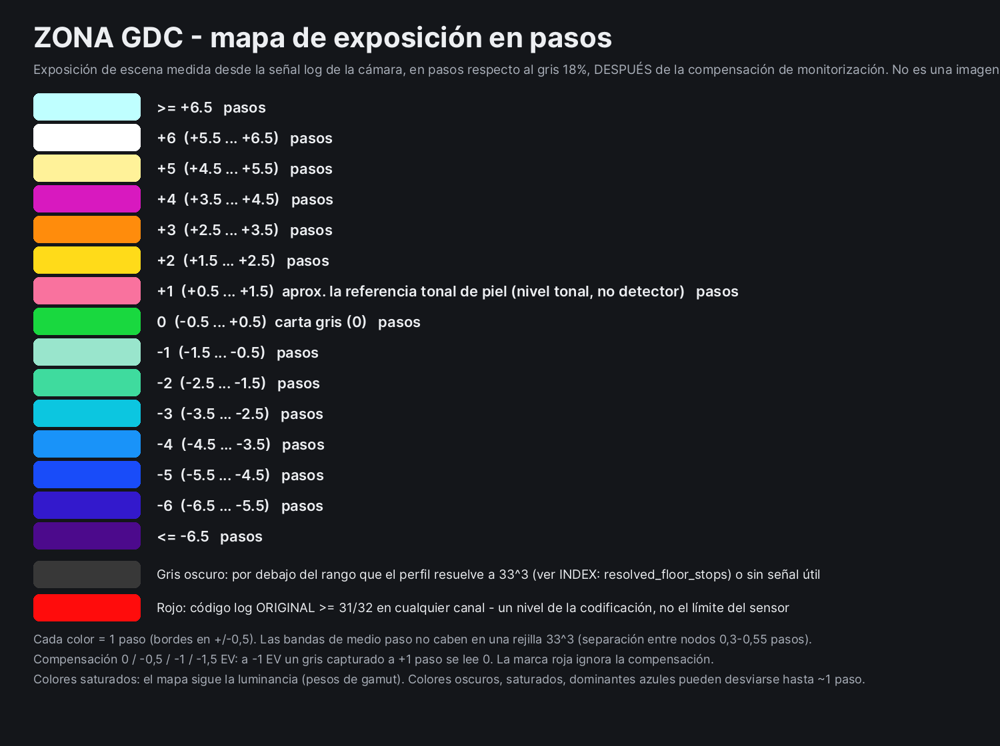

# ZONA GDC — LUTs de monitorización para guía de exposición

**Idiomas:** [English](README.md) · [Română](README.ro.md) · Español · Web: <https://gordas.dev/zona-gdc/> · Proyecto compañero: [ETTR GDC](https://github.com/gordasgdc/ettr-gdc) (LUTs de compensación log → log)

ZONA GDC es un conjunto de LUTs `.cube` 33×33×33 **solo para monitorización**. Se carga en un monitor, visor o previsualización de grabador externo que reciba la señal log de la cámara; el LUT muestra un mapa *diagnóstico* en falso color de la exposición de escena, en pasos respecto al gris 18 %. Es una ayuda de exposición, **no un look ni una corrección de color**.

## Contrato
- **Entrada:** el perfil log del nombre del archivo (p. ej. `VLog-VG` = V-Log / V-Gamut), rango completo, sin otra transformación aplicada.
- **Salida:** mapa diagnóstico en falso color para el monitor, rango completo, sin otra transformación. **No** es log → log (eso lo hace ETTR GDC).
- Aplícalo **una sola vez**. Si el monitor o la cámara ya aplican un LUT/transformación, desactívala o tendrás una doble transformación.
- Solo monitorización: no lo uses para etalonar ni lo grabes a propósito en la grabación principal. Un `.cube` no puede imponer «solo monitor»; según el enrutado del dispositivo, un LUT de monitorización puede aparecer también en las salidas externas grabadas — comprueba tu dispositivo.

## Qué significan los colores
El mapa se calcula **directamente desde la señal log de la cámara**: cada canal se decodifica a scene-linear con la curva del perfil, la luminancia usa los pesos del gamut del perfil y el resultado se expresa en **pasos respecto al gris 18 % tras la compensación de monitorización**. No hay conversión Rec.709, tone mapping ni recorte antes del análisis; los colores de salida son diagnósticos y no necesitan otra transformación.

Un color por paso entero (banda *n* = *n* ± 0,5 pasos). La misma escala para todos los perfiles — ver la imagen de la leyenda:

| Pasos | Color | | Pasos | Color |
|---|---|---|---|---|
| ≥ +6,5 | cian pálido | | −1 | verde-cian pálido |
| +6 | blanco | | −2 | menta |
| +5 | amarillo pálido | | −3 | cian |
| +4 | magenta | | −4 | azur |
| +3 | naranja | | −5 | azul |
| +2 | amarillo | | −6 | índigo |
| **+1** | **rosa** — en torno a la referencia tonal de piel (nivel tonal, no detector de piel) | | ≤ −6,5 | violeta |
| **0** | **verde** — carta gris | | | |

Dos marcas más: **gris oscuro** = por debajo del rango que el perfil resuelve en una rejilla 33³ (o sin señal útil); **rojo** = el código log *original* es ≥ 31/32 en cualquier canal — un nivel de la codificación, **no** un recorte del sensor (los límites del sensor no se deducen del nombre de la curva; la marca roja ignora la compensación, así que no desaparece al oscurecer la imagen).

## Compensación (nombre de archivo `…_MONITOR-<paso>EV.cube`)
`0EV` analiza la imagen tal cual. `m1EV` la analiza tras oscurecerla −1 paso: el gris capturado a +1 paso cae sobre la referencia de gris. Igual `m0_5EV` (−0,5) y `m1_5EV` (−1,5). Sin +0,5 EV en esta versión.

## Límites medidos (33³, interpolado — `INDEX.md`, `audit.json`)
> **Aviso — colores saturados.** El mapa sigue la *luminancia*. Los objetos muy saturados (sobre todo oscuros y de dominante azul) pueden tener un borde de banda desplazado hasta aproximadamente **1 paso**, y en gamuts amplios un azul saturado puede tener luminancia cero o negativa y aparece gris oscuro. El uso fiable es contenido neutro y de tipo piel. No lea las cifras de 0,2–0,4 pasos en neutros como precisión para colores saturados.

- **Pasos enteros, no medios pasos.** Los nodos de la rejilla están a 0,3–0,55 pasos en el eje neutro, así que bandas de 0,5 pasos no se pueden situar con fiabilidad en un LUT 33³.
- **Bordes de banda en neutros** (peor caso en 28 perfiles y 4 compensaciones, rampas de 0,01 pasos): tetraédrico ≤ 0,44 pasos, trilineal ≤ 0,29.
- **Sombras.** Cada perfil tiene un *umbral resuelto* (`INDEX.md`): entre aprox. −1,6 y −5,2 pasos a 0 EV la separación entre nodos supera 0,7 pasos y no se pueden situar bordes; lo más oscuro se muestra gris oscuro, nunca en un color equivocado. La compensación desplaza el umbral el mismo número de pasos.
- **Colores saturados** (64 colores de prueba, desplazamiento local del borde frente al modelo analítico): el 99 % de los casos dentro de 0,54 pasos en el peor perfil, ≤ 0,6 % por encima de 1 paso; los mayores valores alcanzan la ventana de búsqueda de 1,5 pasos («al menos 1,5»). La nota anterior «≈ 7 pasos» fue un artefacto de medida de la auditoría antigua (colores fuera de rango, emparejado por el cruce más cercano) y queda retirada.
- **Material real** (Panasonic V-Log, 50 fps, dos clips, solo pruebas locales): ver `CHANGELOG.md`.
- El error puntual en 8 bits es grande en los bordes por construcción. No probado en monitores, visores ni grabadores físicos; los umbrales no están garantizados en hardware que remuestrea o aplica su propia interpolación. No se afirma equivalencia con ninguna herramienta nativa de exposición.

## Contenido
28 perfiles por marca (Sony, Canon, Panasonic, ARRI, RED, Blackmagic, Nikon, Fujifilm, Apple, FilmLight, DaVinci, ACES), 4 LUTs cada uno; `Sony/_Viewfinder_6char/` contiene copias con nombre corto para visores con nombres de 6 caracteres. `INDEX.csv/md`, `STATS.json`, `catalog.json`, `audit.json`, `MANIFEST_SHA256.txt`, imágenes de leyenda RO/EN/ES. No incluido: GoPro Protune (sin fuente verificada de gama).

## Licencia y atribución

Las LUTs pregeneradas y la documentación de esta distribución se licencian bajo **Creative Commons Atribución 4.0 Internacional (CC BY 4.0)** — https://creativecommons.org/licenses/by/4.0/deed.es (`LICENSE`). Puedes usarlas, copiarlas, modificarlas y redistribuirlas, también con fines comerciales, **siempre que cites a «Dumitru Cristinel Gordas — ZONA GDC», enlaces la licencia e indiques si hiciste cambios.** Componentes de terceros y procedencia: `docs/PROVENANCE.md`. Proyecto independiente, sin afiliación ni respaldo de ningún fabricante de cámaras o software; los nombres de marca solo identifican los formatos que publican.
