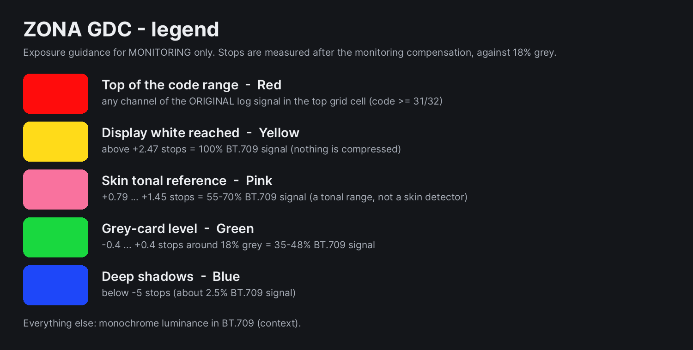

# ZONA GDC — exposure guidance monitoring LUTs

**Languages:** English · [Română](README.ro.md) · [Español](README.es.md) · Website: <https://gordas.dev/zona-gdc/> · Companion project: [ETTR GDC](https://github.com/gordasgdc/ettr-gdc) (log → log compensation LUTs)

ZONA GDC is a set of 33×33×33 `.cube` LUTs for **monitoring only**. Load one on a monitor, viewfinder or external recorder preview that receives the camera's log signal; the LUT shows a Rec.709 *diagnostic* picture: a monochrome luminance image with colour bands at defined exposure levels. It is an exposure aid, **not a look and not a colour correction**.

## Contract
- **Input:** the log profile named in the file (e.g. `VLog-VG` = V-Log / V-Gamut), full-range, no other transform applied.
- **Output:** Rec.709 diagnostic image, display-encoded with the BT.709 OETF, full range. It is **not** log → log (that is ETTR GDC).
- Apply it **once**. If the monitor or camera already applies a LUT/transform, switch that off or you get a double transform.
- Monitoring only: do not use it to grade, and do not bake it into the main recording on purpose. A `.cube` cannot enforce "monitor only"; depending on the device's routing, a monitoring LUT may also appear in recorded external outputs — check your device.

## What the colours mean
Stops are measured **after** the monitoring compensation against 18 % grey (`Y = luminance of the scene-linear signal ÷ 2^comp`).

| Colour | Meaning | Interval |
|---|---|---|
| Red | top of the code range of the **original** log signal | any channel with code ≥ 31/32 |
| Yellow | display white reached | above +2.47 stops (100 % BT.709 signal); nothing is compressed |
| Pink | skin **tonal** reference | +0.79 … +1.45 stops = 55–70 % BT.709 signal (working convention, not a standard; not a skin detector) |
| Green | grey-card level | −0.4 … +0.4 stops = 35–48 % BT.709 signal |
| Blue | deep shadows | below −5 stops (≈ 2.5 % BT.709 signal) |
| grey | everything else | monochrome BT.709 luminance (context) |

The pink band is a tonal range only: any bright wall or sky in that range turns pink too. "Yellow" means the **monitoring picture** would clip; it is not a statement about sensor clipping (no camera data is used). Red is evaluated on the original input codes, so the warning about the real signal limit does not disappear when you compensate.

## Compensation (file name `…_MONITOR-<step>EV.cube`)
`0EV` analyses the image as it is. `m1EV` analyses it after a −1 stop darkening: grey captured at +1 stop falls on the grey reference. Same for `m0_5EV` (−0.5) and `m1_5EV` (−1.5). No +0.5 EV in this release.

## Measured precision (33³, interpolated — see `INDEX.md`, `audit.json`)
The audit evaluates the **interpolated** cube (trilinear and tetrahedral, 0.01-stop ramps) against the analytic model.
- Band-edge position on neutral (grey) ramps: worst 0.18 stop, typical 0.06 stop (tetrahedral).
- Bands are narrow relative to the grid: inside the 0.8-stop grey band the colour reaches 55–85 % coverage depending on the profile (the rest is a blend with the monochrome picture). 4 profiles with the lowest coverage or unrepresentable saturated colours are **experimental**: `LogC4_AWG4`, `Film-Gen5_BMD-WG-Gen5`, `DaVinci-Intermediate_DWG`, `ACEScct_AP1`.
- Strongly saturated colours: band edges can be displaced by several stops (worst test colour ≈ 7 stops); the cause was not investigated further. Do not rely on band edges for highly saturated objects.
- Pointwise 8-bit error is large (up to ~100 codes) exactly at band edges, because the bands are sharp-edged and the grid is 33³; away from the edges it is small. Edges move smoothly with exposure (no flicker was found: 0.7 % of pixels change band between frames on a moving test clip at −1 EV).
- Not tested on physical monitors, viewfinders or external recorders. Exact thresholds are **not guaranteed** on untested hardware (the device may re-sample, clamp or use its own interpolation).

## Contents
28 profiles by brand (Sony, Canon, Panasonic, ARRI, RED, Blackmagic, Nikon, Fujifilm, Apple, FilmLight, DaVinci, ACES), 4 LUTs each; `Sony/_Viewfinder_6char/` has short-name copies for viewfinders with 6-character file names. `INDEX.csv/md`, `STATS.json`, `catalog.json`, `audit.json`, `MANIFEST_SHA256.txt`, legend images RO/EN/ES. Not included: GoPro Protune (no verified gamut source).

## Licence and attribution

The pre-generated LUTs and the documentation in this distribution are licensed under **Creative Commons Attribution 4.0 International (CC BY 4.0)** — https://creativecommons.org/licenses/by/4.0/ (`LICENSE`). You may use, copy, modify and redistribute them, including commercially, **as long as you credit “Dumitru Cristinel Gordas — ZONA GDC”, link the licence and indicate if you made changes.** Third-party components and provenance: `docs/PROVENANCE.md`. Independent project, not affiliated with or endorsed by any camera or software manufacturer; brand names only identify the formats they publish.
