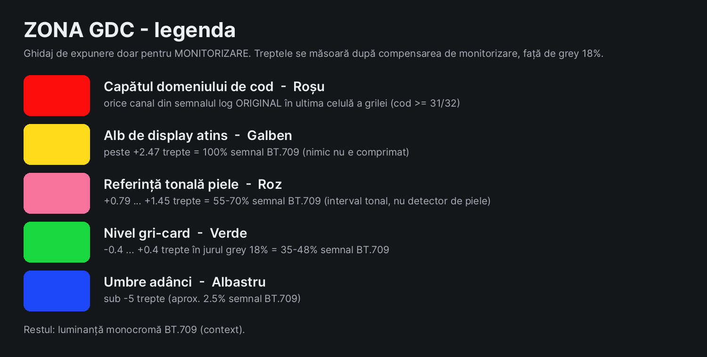

# ZONA GDC — LUT-uri de monitorizare pentru ghidaj de expunere

**Limbi:** [English](README.md) · Română · [Español](README.es.md) · Site: <https://gordas.dev/zona-gdc/> · Proiect însoțitor: [ETTR GDC](https://github.com/gordasgdc/ettr-gdc) (LUT-uri de compensare log → log)

ZONA GDC este un set de LUT-uri `.cube` 33×33×33 **doar pentru monitorizare**. Se încarcă pe un monitor, vizor sau previzualizare de recorder extern care primește semnalul log al camerei; LUT-ul arată o imagine Rec.709 de *diagnostic*: luminanță monocromă cu benzi colorate la niveluri de expunere definite. Este un ajutor de expunere, **nu un look și nu o corecție de culoare**.

## Contract
- **Intrare:** profilul log din numele fișierului (ex. `VLog-VG` = V-Log / V-Gamut), full range, fără altă transformare aplicată.
- **Ieșire:** imagine Rec.709 de diagnostic, codată cu OETF BT.709, full range. **Nu** este log → log (asta face ETTR GDC).
- Aplică-l **o singură dată**. Dacă monitorul sau camera aplică deja un LUT/transformare, oprește-o, altfel ai dublă transformare.
- Doar monitorizare: nu îl folosi pentru etalonare și nu îl „arde" intenționat în înregistrarea principală. Un `.cube` nu poate impune „doar monitor"; în funcție de rutarea dispozitivului, un LUT de monitorizare poate apărea și în ieșirile externe înregistrate — verifică dispozitivul.

## Ce înseamnă culorile
Treptele se măsoară **după** compensarea de monitorizare, față de grey 18 % (`Y = luminanța semnalului scene-linear ÷ 2^comp`).

| Culoare | Semnificație | Interval |
|---|---|---|
| Roșu | capătul domeniului de cod al semnalului log **original** | orice canal cu cod ≥ 31/32 |
| Galben | alb de display atins | peste +2,47 trepte (100 % semnal BT.709); nimic nu e comprimat |
| Roz | referință **tonală** pentru piele | +0,79 … +1,45 trepte = 55–70 % semnal BT.709 (convenție de lucru, nu standard; nu detectează piele) |
| Verde | nivel gri-card | −0,4 … +0,4 trepte = 35–48 % semnal BT.709 |
| Albastru | umbre adânci | sub −5 trepte (≈ 2,5 % semnal BT.709) |
| gri | restul | luminanță monocromă BT.709 (context) |

Roz este doar un interval tonal: orice perete luminos sau cer din acel interval devine roz. „Galben" înseamnă că **imaginea de monitorizare** ar tăia; nu e o afirmație despre tăierea senzorului (nu se folosesc date de cameră). Roșul se evaluează pe codurile originale de intrare, deci avertismentul despre limita reală a semnalului nu dispare la compensare.

## Compensare (nume fișier `…_MONITOR-<pas>EV.cube`)
`0EV` analizează imaginea ca atare. `m1EV` o analizează după o întunecare de −1 treaptă: grey capturat la +1 treaptă cade pe referința de grey. La fel `m0_5EV` (−0,5) și `m1_5EV` (−1,5). Fără +0,5 EV în această versiune.

## Precizie măsurată (33³, interpolat — vezi `INDEX.md`, `audit.json`)
Auditul evaluează cubul **interpolat** (trilinear și tetraedric, rampe de 0,01 trepte) față de modelul analitic.
- Poziția marginii benzii pe rampe neutre (gri): cel mai rău 0,18 trepte, tipic 0,06 trepte (tetraedric).
- Benzile sunt înguste față de grilă: în banda de grey de 0,8 trepte culoarea atinge 55–85 % acoperire, în funcție de profil (restul e amestec cu imaginea monocromă). 4 profile cu acoperire minimă sau culori saturate nereprezentabile sunt **experimentale**: `LogC4_AWG4`, `Film-Gen5_BMD-WG-Gen5`, `DaVinci-Intermediate_DWG`, `ACEScct_AP1`.
- Culori puternic saturate: marginile benzilor se pot deplasa cu mai multe trepte (cea mai rea culoare de test ≈ 7 trepte); cauza nu a fost investigată mai departe. Nu te baza pe marginile benzilor pentru obiecte foarte saturate.
- Eroarea punctuală pe 8 biți este mare (până la ~100 de coduri) exact la marginile benzilor, fiindcă benzile au margini ascuțite iar grila e 33³; departe de margini e mică. Marginile se mișcă lin cu expunerea (nu s-a găsit flicker: 0,7 % din pixeli schimbă banda între cadre pe un clip în mișcare la −1 EV).
- Netestat pe monitoare, vizoare sau recordere externe fizice. Pragurile exacte **nu sunt garantate** pe hardware netestat (dispozitivul poate reeșantiona, tăia sau folosi propria interpolare).

## Conținut
28 de profile pe branduri (Sony, Canon, Panasonic, ARRI, RED, Blackmagic, Nikon, Fujifilm, Apple, FilmLight, DaVinci, ACES), câte 4 LUT-uri; `Sony/_Viewfinder_6char/` are copii cu nume scurt pentru vizoare cu nume de fișier de 6 caractere. `INDEX.csv/md`, `STATS.json`, `catalog.json`, `audit.json`, `MANIFEST_SHA256.txt`, imagini de legendă RO/EN/ES. Neincluse: GoPro Protune (fără sursă verificată pentru gamă).

## Licență și atribuire

LUT-urile pregenerate și documentația din această distribuție sunt licențiate sub **Creative Commons Atribuire 4.0 Internațional (CC BY 4.0)** — https://creativecommons.org/licenses/by/4.0/deed.ro (`LICENSE`). Le poți folosi, copia, modifica și redistribui, inclusiv comercial, **cu condiția să menționezi „Dumitru Cristinel Gordas — ZONA GDC”, să oferi linkul licenței și să indici dacă ai făcut modificări.** Componente terțe și proveniență: `docs/PROVENANCE.md`. Proiect independent, fără afiliere sau susținere din partea vreunui producător de camere sau software; numele de brand identifică doar formatele pe care le publică.
